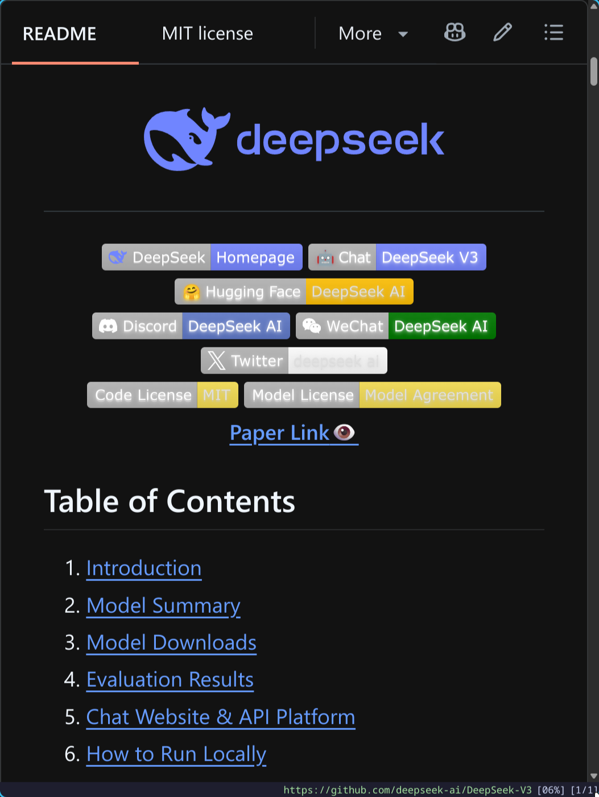
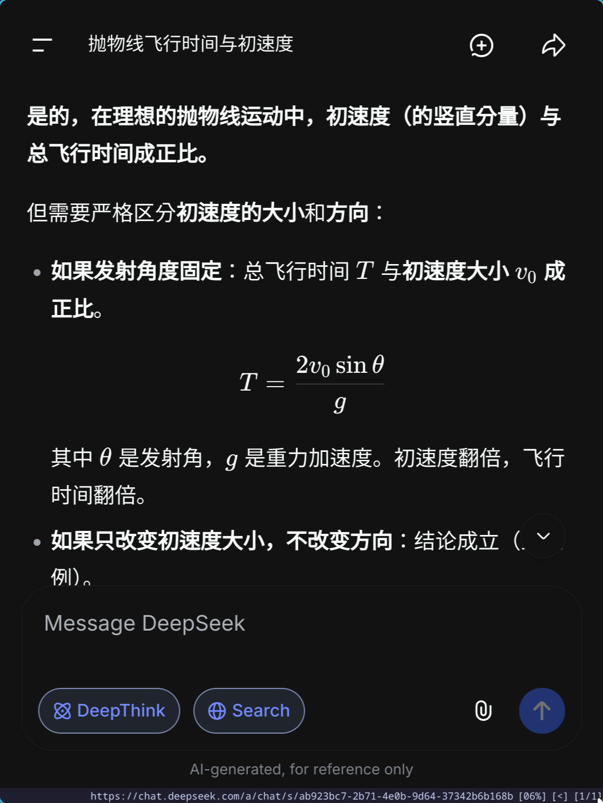
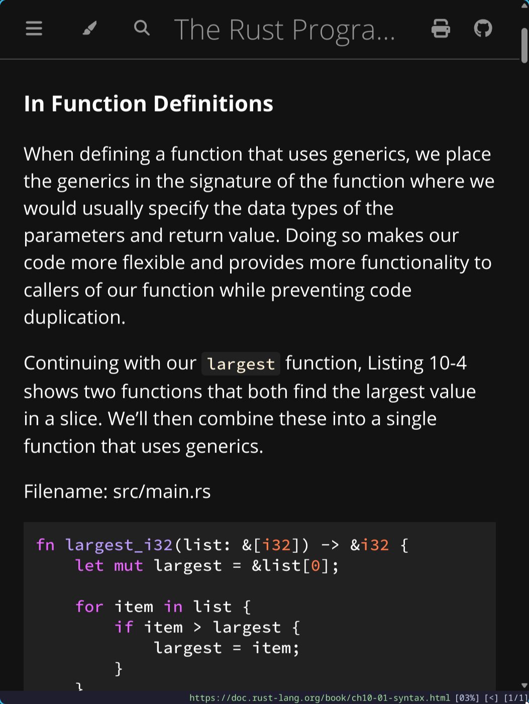
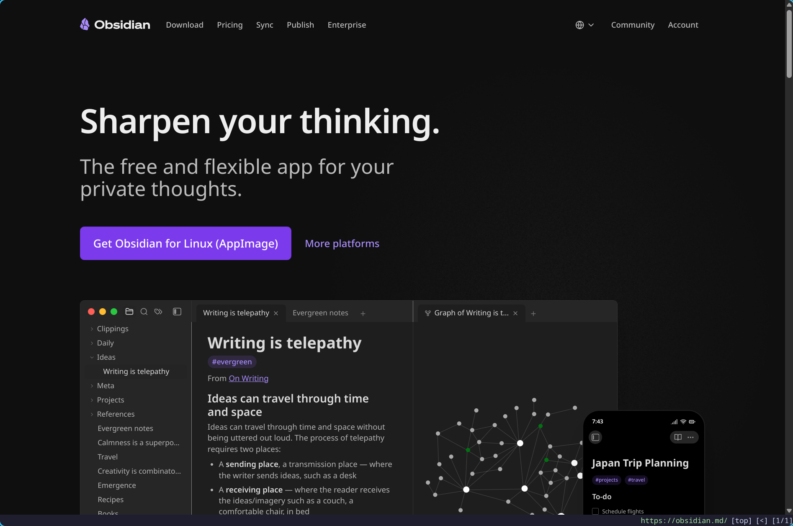
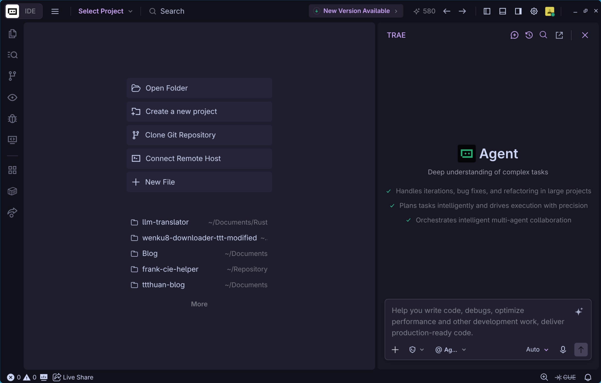
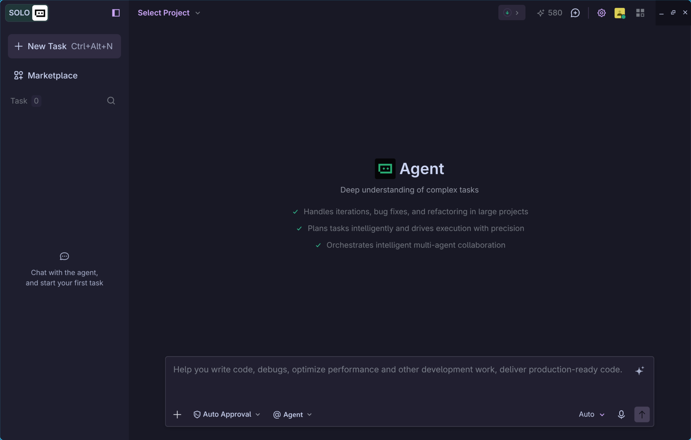

> 致敬：[The Missing Semester of Your CS Education](https://missing.csail.mit.edu/)

- [Introducation](#introducation)
- [Markdown](#markdown)
  - [基本语法](#基本语法)
  - [Markdown编辑器](#markdown编辑器)
- [AI领域的基础概念](#ai领域的基础概念)
- [AI编辑器](#ai编辑器)
- [DeepSeek Harness + Agents](#deepseek-harness--agents)
  - [API Key](#api-key)
  - [Agents](#agents)
- [Git + GitHub](#git--github)
- [Python + Javasript](#python--javasript)

## Introducation

- AI时代想要写程序非常容易，任何人都可以做到。但是这也不意味着现在的人们可以不用了解任何知识，反而是所有人都应该掌握基本的计算机常识。

## Markdown

- Markdown是一种*轻量型标记语言*
- Markdown文件通过**纯文本**的方式储存
- 在计算机领域运用十分广泛

| GitHub项目详情页                                             | AI输出内容                                                   | 项目文档                                                     |
| ------------------------------------------------------------ | ------------------------------------------------------------ | ------------------------------------------------------------ |
|  |  |  |

### 基本语法

语法参考：

- https://markdown.com.cn/basic-syntax/

- https://www.bilibili.com/video/BV1V4gVzBEGT/

```markdwon
# H1 标题
## H2 标题
### H3 标题
#### H4 标题
##### H5 标题
###### H6 标题

### 文本样式
**粗体文本**、*斜体文本*、***粗斜体文本***、~~删除线文本~~

### 表格
| 功能 | 支持情况 | 备注 |
|------|----------|------|
| 表格 | ✓ 支持 | 对齐测试 |
| 任务列表 | ✓ 支持 | 见下方 |
| 表情符号 | :smile: :rocket: | 使用冒号语法 |
| 自动链接 | https://github.com | 自动识别 |
| 删除线 | ~~不支持~~ | 已支持 |

### 任务列表
- [x] 已完成的任务
- [ ] 未完成的任务
- [ ] 另一个未完成的任务
  - [x] 嵌套任务（如果支持）
```

### Markdown编辑器

> 个人推荐Obsidian这个软件来写markdown文件

官网地址： <https://obsidian.md/>



## AI领域的基础概念

- 大语言模型 LLM - 最底层的模型本身（`deepseek-ai/DeepSeek-V4.1-Flash`，
- vibe coding - 用过自然语言和AI沟通的方式，指挥AI编程
- AI agent - 有调用工具能力的AI（通常专注某个特定的任务）
- harness - 围绕着AI模型设计的一套框架、工作流
- Skill - 可以简单理解为一套“预先设定好的提示词”，告诉AI怎么处理一些特定的场合

## AI编辑器

> 个人推荐：TRAE <https://www.trae.cn/>





- 注册并登陆账号

推荐插件：

- Catppuccin for VSCode + Catppuccin Perfect Icons
- Live Share
- Markdown All in One

## DeepSeek Harness + Agents

官方桌面版：<https://www.deepseek.com/harness/>

npm包版：`npm insall -g @deepseek-ai/dsh`

使用DeepSeek Harness不像使用网页端/移动端的对话AI，可以直接免费使用。相对而言电脑上可以使用各种工具的agents更加耗费算力，所以需要付费使用。

### API Key

> API（Application Programming Interface）- 访问服务的接口

一般来说需要去专门的模型提供商购买使用模型的服务，购买之后服务商会给一个叫API key的东西，API key可以作为一个凭证在其他程序中使用服务商的服务。

AI模型提供商（国内）：

- <https://platform.deepseek.com/>
- <https://platform.kimi.com/>
- <https://open.bigmodel.cn/>
- <https://www.siliconflow.cn/>
- <https://www.modelscope.cn/>

### Agents

- Claude Code
- OpenCode
- Codex
- Pi
- DeepSeek Harness TUI

## Git + GitHub

Git - 一个分布式版本控制系统

- Windows版本下载：<https://mirrors.tuna.tsinghua.edu.cn/github-release/git-for-windows/git/LatestRelease/>

GitHub <https://github.com/> - 基于Git的代码托管平台

---

## Python + Javasript

Python和Javascript几乎算是AI时代最常使用的两个编程语言。

- 写网页应用基本上都是用Javascript写的（或者说JS的超集Typescript）
- 其余的应用基本上都可以用Python写，python语法简单而且第三方库非常丰富

