起因：在学习FitzHugh-Nagumo Model以及分析它的phase plane时，我发现我只知道微积分的一些皮毛知识，对于怎么应用微分方程一无所知。所以我决定学习一下。

参考视频：[Differential Equations: The Language of Change - YouTube](https://www.youtube.com/watch?v=vTTlzmCRwU4)

## State Variables

State variable是描述一个系统的真实的数字，这包括：

- 重力加速度
- 当前物体的位置
- 一个population的大小

具体选择哪些state variable取决于一个model要设计得多复杂。

> Models are designed to describe a specific aspect of the worlds, while discarding others.

例如，对于一个pendulum来说，可以用垂直夹角$\theta$和角速度$w$来描述当前的状态（如果忽略其他微小的影响因素的话）：

$$
\begin{bmatrix}
\theta \\
\omega
\end{bmatrix}
$$

而如果要考虑其他因素，例如温度、旋转、气压...的话，就需要一个更加复杂的model来描述。

## Formalism of Differential Equations

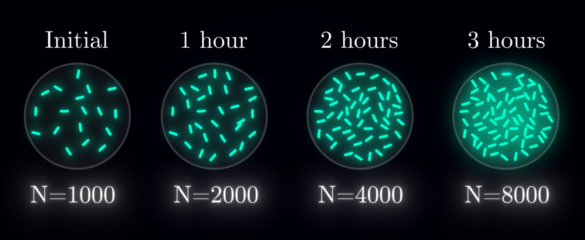

想象一个长着细菌的培养皿，细菌的数量会每隔一个小时翻一倍，如果用数学的语言来描述的话就是：

$$
N(t+1) = 2N(t)
$$

其中$N(t)$是当前小时的数量，$N(t + 1)$是下一个小时的数量。

这样写法的不足之处在于没办法知道在一个小时之间细菌数量是如何变化的，细菌不可能在一个小时当中什么变化都没有，而一个小时后直接变成一倍的数量。

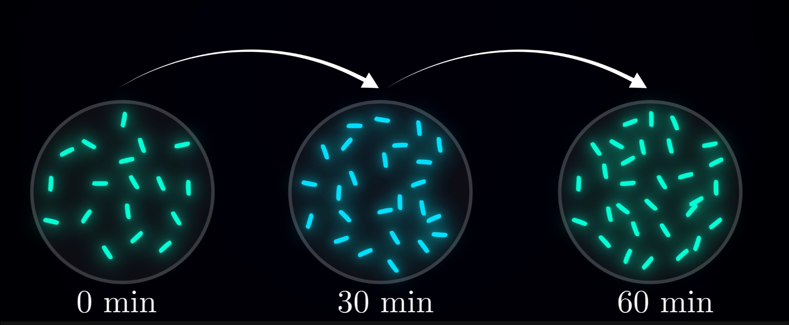

首先，我们需要知道细菌的数量是如何变化的，也就是说我们需要知道“**Rate of Change**”：$\text{New bacteria} / \text{hour}$

在细菌这个例子中，每个时间段中增长的量相当于**当前正在分裂的细菌数量**，我们可以定义$\dot{N}$为当前正在分裂的细菌数量。而$k$则是当前种群中，正在分裂的细菌所占的比例。根据这个关系，可以得到：

$$
\dot{N} = kN
$$

而上面这个式子就算是一种Differential equation了。

> Differential equations relate the **value of a state wariable** to its **rate of change**

数学中，这个rate of change被称为derivative导数：
$$
\dot{N} = \frac{dN}{dt}
$$
其中$dN$是**瞬时**增加的种群大小，$dt$是一个很小的时间。

不过本身细菌的数量不可能有小数点，所以实际计算的时候还需要一些其他的操作：将continuous changes转换成discrete changes。

这时用$\Delta$来表示这种很小的一步，但这一小步不是continuous的：
$$
\dot{N} = \frac{\Delta N}{\Delta t}
$$
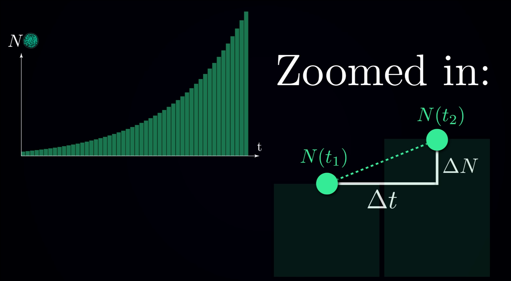

通过计算每一次$\Delta N$的方法，得出在一定时间后种群大小的方法，被称为**Numerical Method**。

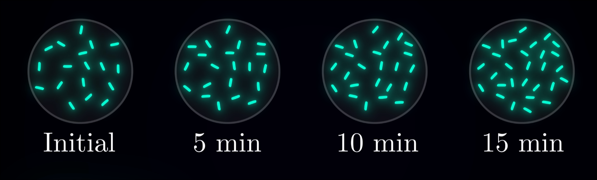

我们假设五分钟已经足够小了，这种群每次增长的速率是一个恒定的值。

在最开始的时候：有1000个细菌，每小时增加的量为$\dot N _{\text{hour}} = 1000$，每分钟增加的量为$\dot N _{\text{min}} = \frac{1000}{60} \approx 17$。
$$
\begin{aligned}
N_5 &\approx 1000 + \left(17 \cdot 5 \text{ min}\right) = 1085 \\
\dot N &= \frac{1085}{60} \approx 18 \\
N_{10} &\approx 1085 + \left(18 \cdot 5 \text{ min}\right) = 1175 \\
\dot N &= \frac{1175}{60} \approx 20 \\
N_{15} &\approx 1175 + \left(20 \cdot 5 \text{ min}\right) = 1275
\end{aligned}
$$
并以此类推。

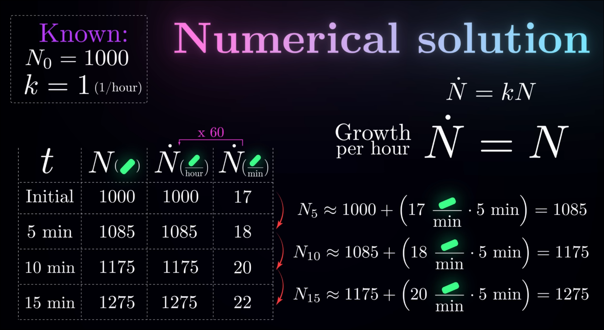

---

如果使用continuous的方式去解决这个问题：
$$
\begin{aligned}
\frac{dN}{dt} &= kN \\
N(t) &= N_0 e^{kt}
\end{aligned}
$$

- $N$随时间变化而变化
- $N_0$ 是初始的 $N$ 值

> 使用高中的知识推导：
>
> $$
> \begin{aligned}
> \frac{dN}{dt} &= kN \\
> \frac{1}{N} \frac{dN}{dt} &= k \\
> \frac{1}{N} \, dN &= k \, dt \\
> \ln N &= kt + C \\
> \end{aligned}
> $$
> 
> when $t=0$, $N = N_0$:
> 
>$$
> \begin{aligned}
>\ln N &= kt + \ln N_0 \\
> N &= N_0 e^{kt}
> \end{aligned}
> $$

这种方法被称为**analytical solution**。

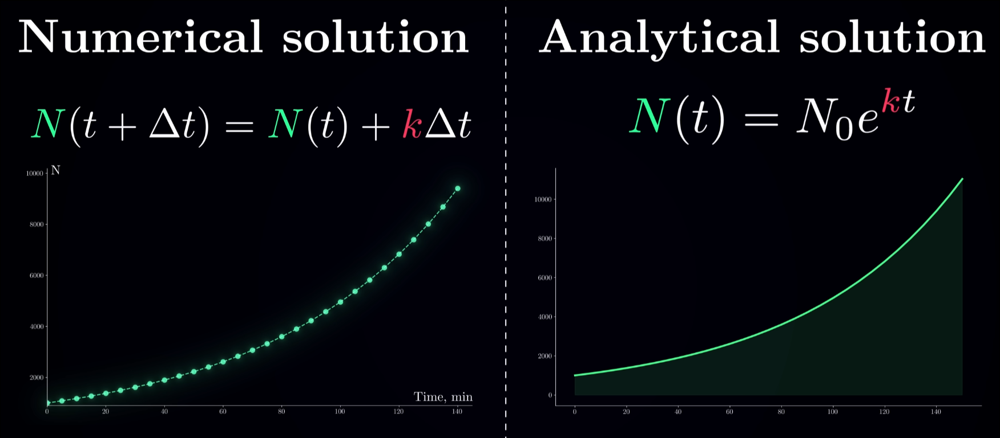

| Numerical Solution                 | Analytical Solution          |
| ---------------------------------- | ---------------------------- |
| 有许多步精确的计算结果组成         | 直接有一个公式               |
| 要计算一个值，需要非常大的前置计算 | 带入公式即可获得任一时间的值 |
| 有限的精确度                       | 精确值                       |

在一般情况下，我们也不会知道每个state variable / parameter的确切值，通常我们需要做实验，然后将时间数据和预估的parameter做比较。

## Coupled Differential Equations

$$
\dot{x} = f(x, y)  \\
\dot{y} = g(x, y)
$$

很多时候一个变量的值取决于多个变量共同影响下的结果。

例如著名的rabbit-fox问题：

- 更多的rabbit会给fox提供更多食物，让fox的数量变多
- 更多的fox会捕食更多的rabbit，导致rabbit的数量变少

建立rabbit变量和fox变量之间的联系：

- $\dot x$: rabbit种群数量的变化
- $\dot y$: fox种群数量的变化

$$
\begin{cases}
\dot{x} = f(x, y) \\
\dot{y} = g(x, y)
\end{cases}
$$

关于rabbit的数量会如何变化：

1. 自然出生：$+ ax$ 种群中出生新rabbit的比例
2. 被捕食：$- bxy$ 被捕食的速率。$xy$指的是rabbit遇到fox的情况，正比于被捕食的速率，所以再乘上系数$-b$

所以$\dot{x}$为：$ax - bxy$

同理，fox的变化与rabbit的变化相似：捕食的速率决定了fox的增长速率（$cxy$），fox本身也有一个自然的死亡率（$-dy$）。
$$
\begin{aligned}
\dot{x} &= ax - bxy \\
\dot{y} &= cxy - dy
\end{aligned}
$$
当设置了parameter和intial state之后，就可以自然计算出之后rabbit和fox的数量会如何变化了：

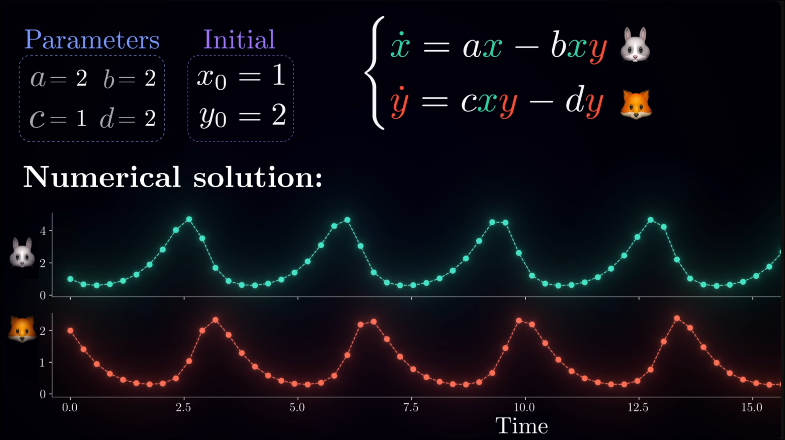

这个图可以画在**phase plane** / **phase space**上，在这种图上：

- 每个点代表了当前的x和y的状态（当前值）
- 没有时间t的信息
- x和y的变化率可以使用一个向量来表示

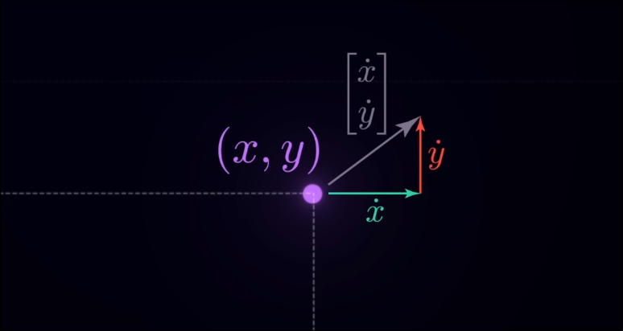

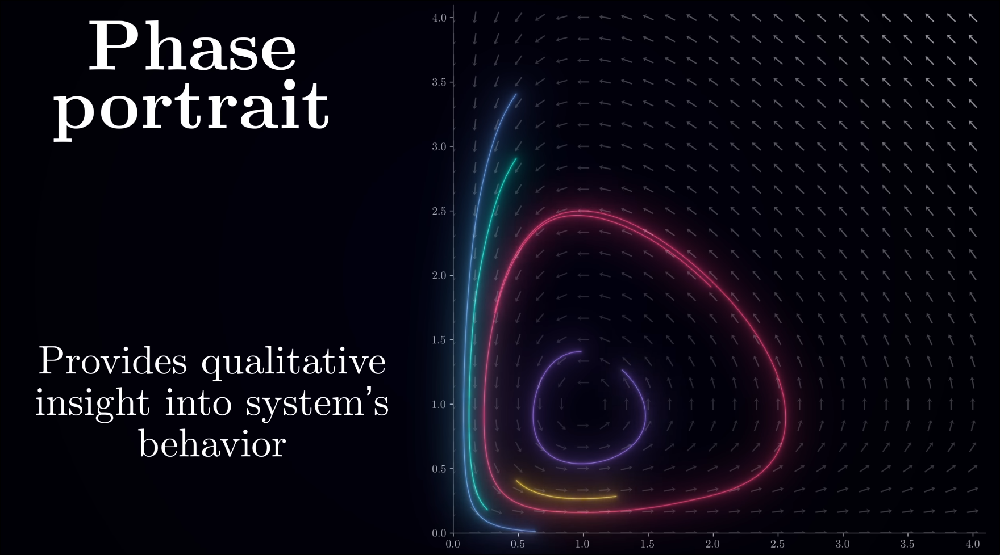

当一个点的向量为zero-vector时，这个点不会变化，这个点被称为**equilibrium point**：
$$
\begin{cases}
\dot{x} = ax - bxy = 0 \\
\dot{y} = cxy - dy = 0
\end{cases}
$$
可以解这个方程组：
$$
\begin{cases}
x = 0 \\
y = 0
\end{cases}
\quad \text{or} \quad
\begin{cases}
x = \frac{d}{c} \\
y = \frac{a}{b}
\end{cases}
$$
除了这个equilibrium point的情况，还有当某一个值为0的情况也值得注意：

- 当x为0，y会一直减少至0
- 当y为0，x会一直增加至$\infin$

除了这些情况，其他时候的变化都可以形成一个闭环，这个闭环被称为**limit cycle**。

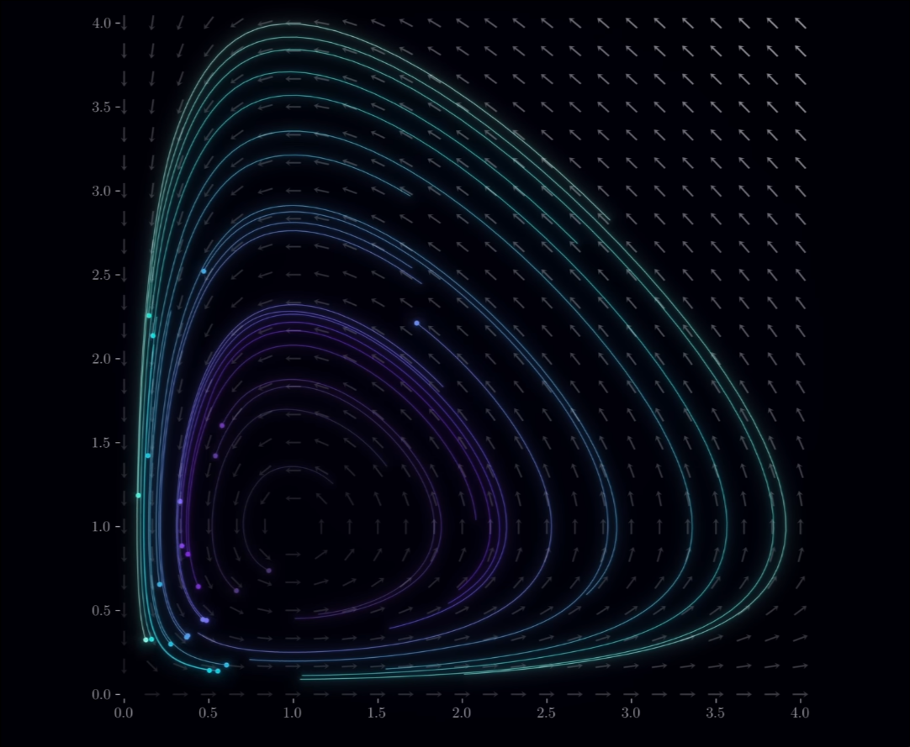

在原本公式的基础上，可以添加$K$作为rabbit食物的限制：
$$
\begin{cases}
\dot{x} = ax\left(1 - \frac{x}{K}\right) - bxy \\
\dot{y} = cxy - dy
\end{cases}
$$
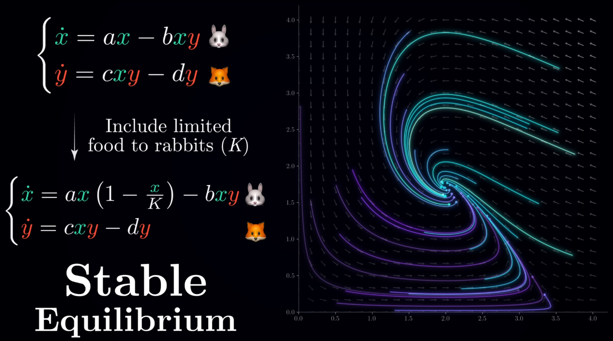

最后rabbit和fox的数量会趋近于平衡，这个状态被称为**Stable Equilibrium**。

---

在结尾我再推荐下这位YouTube博主：[Artem Kirsanov - YouTube](https://www.youtube.com/@ArtemKirsanov)
